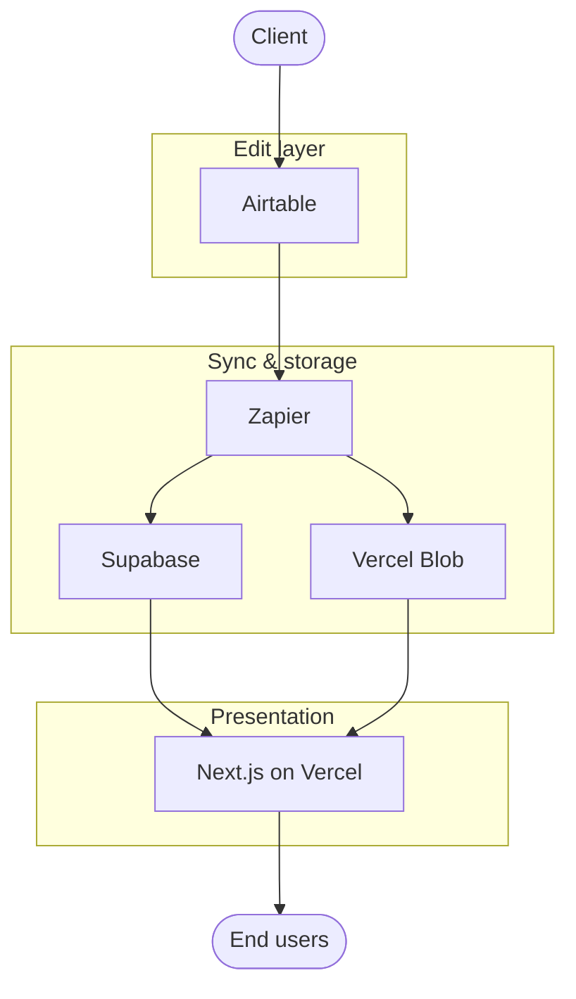
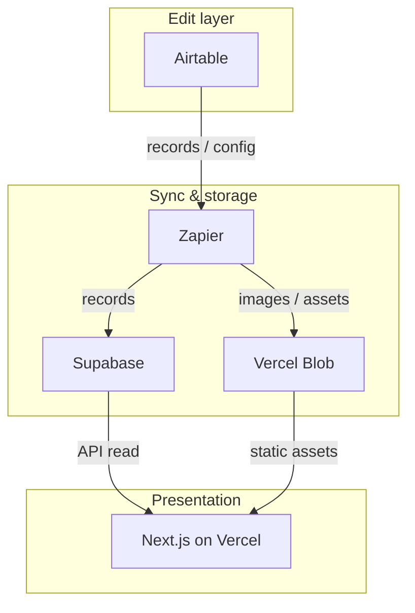

# Architecture Diagram — {{engagement_name}}

**How to use:** Copy this file to your engagement folder. Design the diagrams to match your engagement's actual architecture — the example below shows one common pattern (SOT→sync→store→presentation) but your engagement may require a different structure entirely. Replace all `{{placeholders}}` with specific technology names. Export Mermaid blocks to PNG or SVG using any Mermaid-capable editor if needed for decks or docs.

<!-- LLM_INSTRUCTION
When generating this document:
- Design the architecture to match the engagement's actual needs. Do NOT default
  to the SOT→sync→store→presentation example unless the engagement genuinely
  follows that pattern.
- Fill all node placeholders with specific technology names, not categories.
  "Zapier" not "automation tool." "PostgreSQL" not "database."
- Ensure valid Mermaid syntax: every node referenced in an arrow must be
  declared in a subgraph.
- The two diagrams (context and data flow) MUST use the same node IDs.
  Only labels and edge annotations differ.
- In the narrative, name every technology exactly as it appears in the diagrams.
- Add or remove layers and nodes to match the engagement. Not every engagement
  needs a CDN, a sync layer, or the same number of components.
- Derive the architecture from the context document, discovery checklist, and
  engagement principles — not from the example in this template.
END_LLM_INSTRUCTION -->

---

## Context diagram

Shows systems and actors and how they relate. Use subgraphs to group systems into architectural layers. Node IDs must match the data flow diagram below.

```mermaid
flowchart TB
  subgraph "{{layer_1_name}}"
    A[{{system_1}}]
  end

  subgraph "{{layer_2_name}}"
    B[{{system_2}}]
    C[{{system_3}}]
  end

  subgraph "{{layer_3_name}}"
    D[{{system_4}}]
  end

  {{actor_1}}([{{actor_1_name}}]) --> A
  A --> B
  B --> C
  C --> D
  D --> {{actor_2}}([{{actor_2_name}}])
```

---

## Data flow diagram

Same nodes as context diagram. Arrows show how data moves between systems — label each edge with what flows (e.g. "API read", "webhook", "file upload").

```mermaid
flowchart TB
  subgraph "{{layer_1_name}}"
    A[{{system_1}}]
  end

  subgraph "{{layer_2_name}}"
    B[{{system_2}}]
    C[{{system_3}}]
  end

  subgraph "{{layer_3_name}}"
    D[{{system_4}}]
  end

  A -- "{{data_flow_1}}" --> B
  B -- "{{data_flow_2}}" --> C
  C -- "{{data_flow_3}}" --> D
```

---

## Narrative

{{architecture_narrative}}

<!-- Describe the architecture in plain language: what each system does, how data
flows between them, why this structure was chosen, and any notable constraints
or trade-offs. Reference each system by the same name used in the diagrams. -->

---

## Technology mapping

| Diagram node | Technology | Decision log entry |
|--------------|------------|--------------------|
| A | {{system_1}} | [DEC-{{dec_1_id}}](decision-log.md) |
| B | {{system_2}} | [DEC-{{dec_2_id}}](decision-log.md) |
| C | {{system_3}} | [DEC-{{dec_3_id}}](decision-log.md) |
| D | {{system_4}} | [DEC-{{dec_4_id}}](decision-log.md) |

Add or remove rows to match the number of systems in your diagrams.

No secrets in diagrams. Export Mermaid to PNG/SVG in any Mermaid-capable editor if needed for decks or docs.

---

<details>
<summary>Example: SOT → sync → store → presentation architecture (click to expand)</summary>

This pattern is common for engagements where a client edits content in one system (the source of truth) and it needs to appear on a public-facing website or app.

**Context diagram:**



**Data flow diagram:**



**Narrative:** Edits happen in **Airtable**; the client uses it as the single place to change records and configuration. **Zapier** keeps that source in sync with **Supabase** (for structured data and API reads) and with **Vercel Blob** (for images and other heavy assets). The public-facing **Next.js on Vercel** reads from the data store via API and serves images/media from the CDN, so the site stays read-optimised and the source of truth is not hit directly by end users.

**Technology mapping:**

| Diagram node | Technology | Decision log entry |
|--------------|------------|--------------------|
| SOT | Airtable | DEC-001 |
| SYNC | Zapier | DEC-002 |
| STORE | Supabase | DEC-003 |
| CDN | Vercel Blob | DEC-004 |
| PRES | Next.js on Vercel | DEC-005 |

</details>
